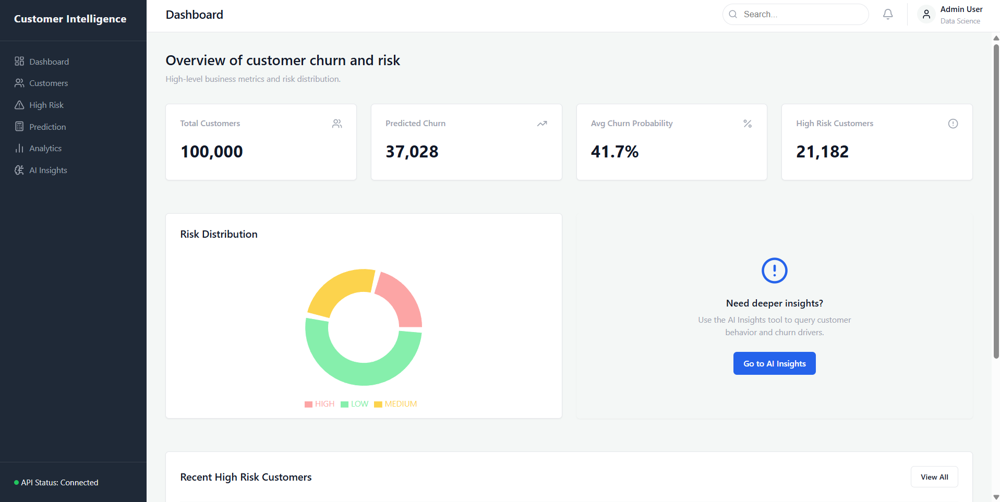
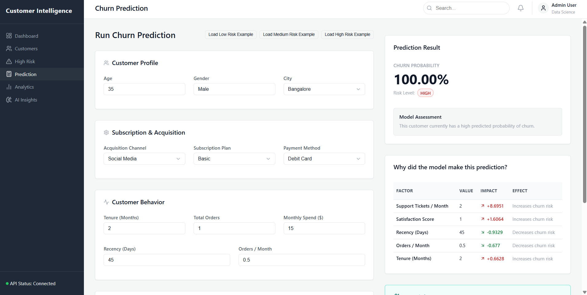
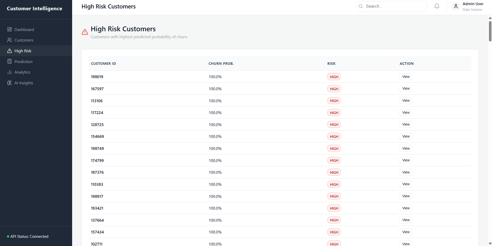
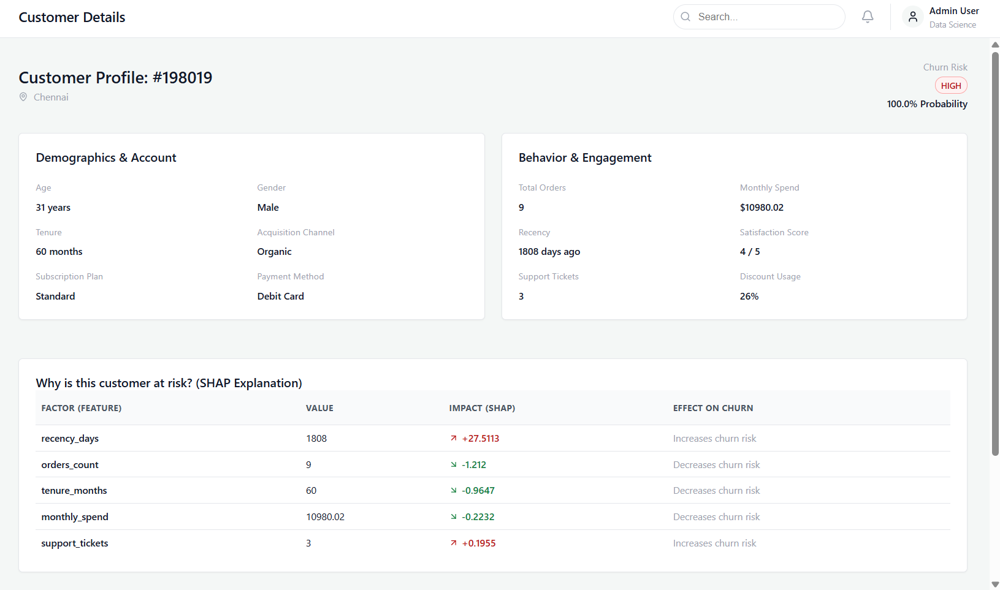
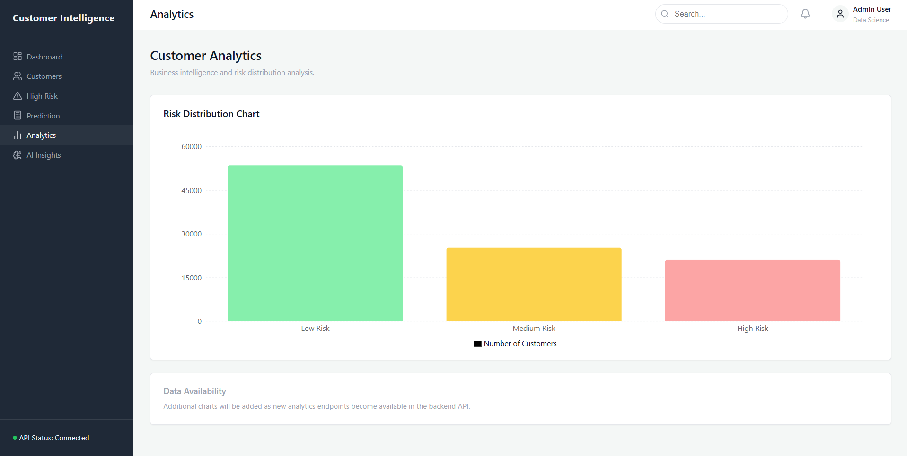
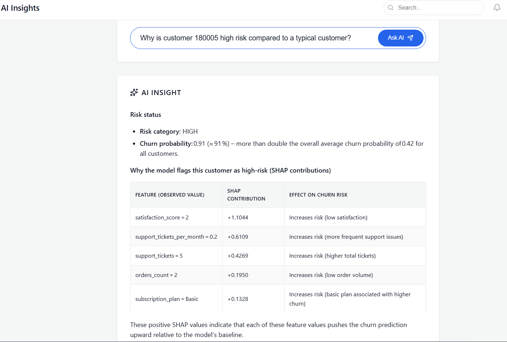
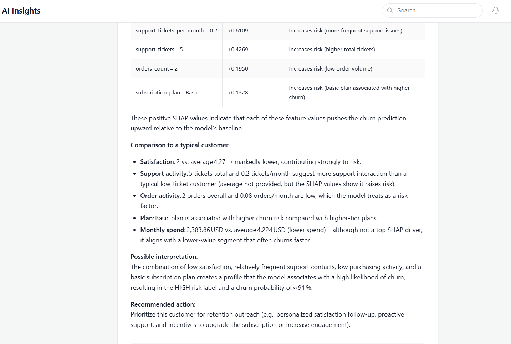
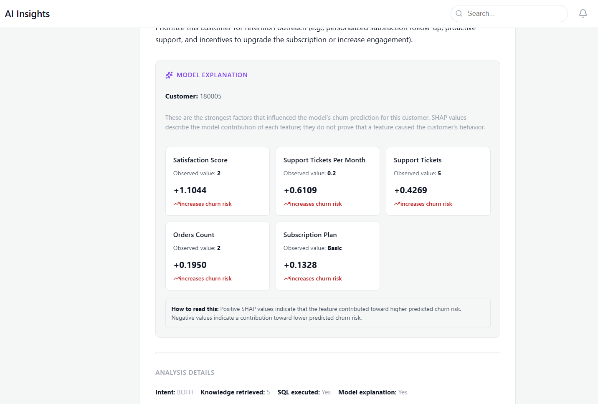
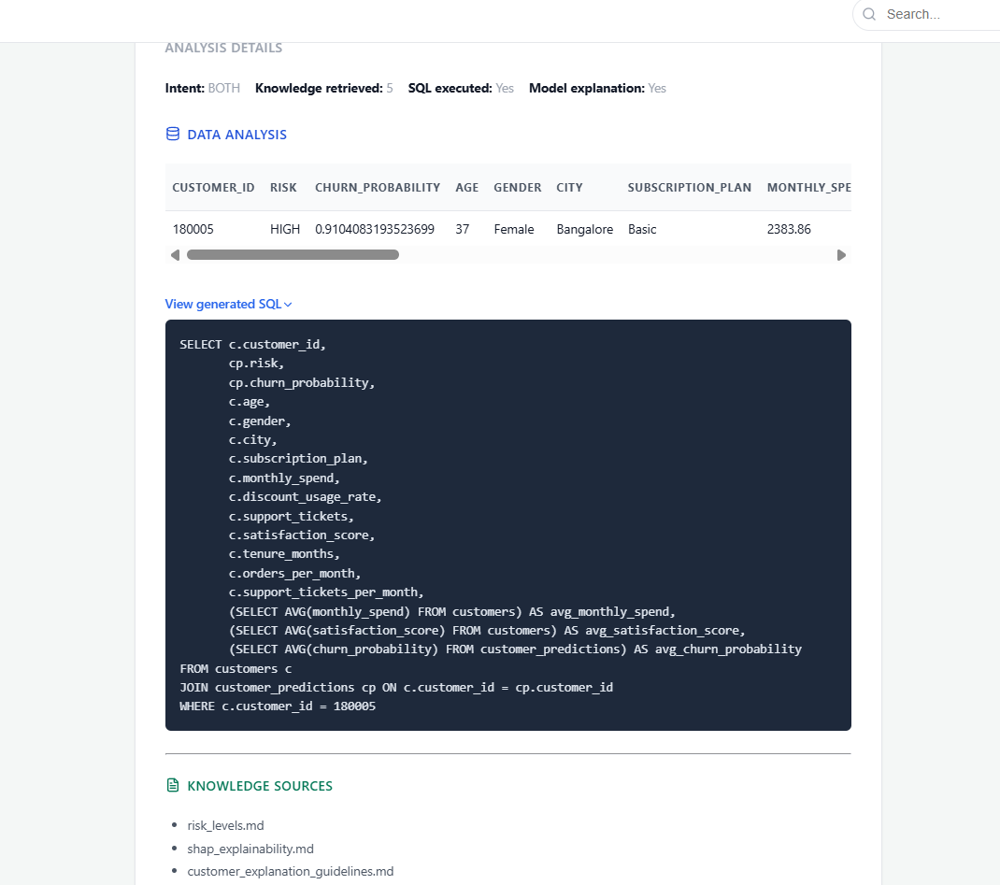
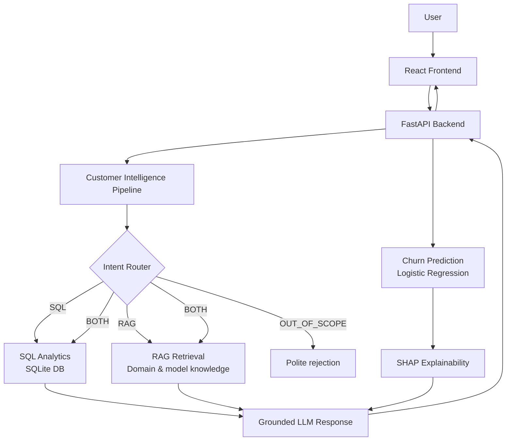

# 🧠 Customer Intelligence — AI-Powered Churn Prediction Platform

An end-to-end **customer intelligence and churn prediction platform** that combines classical machine learning, SQL analytics, Retrieval-Augmented Generation (RAG), SHAP explainability, and an LLM to let users ask natural-language questions about their customers, retention, and the churn model itself.


> **Core flow:** User question → Intent detection → RAG / SQL / SHAP (as appropriate) → Grounded LLM response → FastAPI → React frontend

---

## 📑 Table of Contents

1. [Project Overview](#-project-overview)
2. [Problem Statement & Objectives](#-problem-statement--objectives)
3. [Key Features](#-key-features)
4. [Application Screenshots](#-application-screenshots)
5. [System Architecture](#-system-architecture)
6. [Tech Stack](#-tech-stack)
7. [Project Structure](#-project-structure)
8. [Dataset & Data Processing](#-dataset--data-processing)
9. [Machine Learning Pipeline](#-machine-learning-pipeline)
10. [Model Explainability (SHAP)](#-model-explainability-shap)
11. [SQL Analytics](#-sql-analytics)
12. [Intent Routing](#-intent-routing)
13. [RAG (Retrieval-Augmented Generation)](#-rag-retrieval-augmented-generation)
14. [Backend API Reference](#-backend-api-reference)
15. [Frontend](#-frontend)
16. [Setup & Installation](#-setup--installation)
17. [Environment Variables](#-environment-variables)
18. [Data & Model Artifacts](#-data--model-artifacts)
19. [Docker](#-docker)
20. [Example Questions to Try](#-example-questions-to-try)
21. [Design Decisions](#-design-decisions)
22. [Limitations](#-limitations)
23. [Future Improvements](#-future-improvements)
24. [Assignment Requirement Mapping](#-assignment-requirement-mapping)
25. [Troubleshooting](#-troubleshooting)
26. [Author](#-author)

---

## 📌 Project Overview

Retaining an existing customer is almost always cheaper than acquiring a new one. This project helps a business answer three questions:

1. **Who is likely to churn?** — a trained ML model scores every customer with a churn probability and a risk category (`HIGH`, `MEDIUM`, `LOW`).
2. **Why is that customer at risk?** — SHAP explains which features pushed an individual prediction up or down.
3. **What is happening across the customer base, and what should we do about it?** — SQL analytics provide factual numbers, while RAG provides domain and retention knowledge. An LLM combines them into a clear, grounded answer.

Instead of forcing users to write SQL or read notebooks, they can simply ask:

> *"Which customers are most likely to churn?"*
> *"What is the churn rate by city?"*
> *"Why did the model flag customer 1042 as high risk?"*
> *"What strategies reduce churn for high-discount users?"*

The system detects what kind of question was asked, picks the right tool(s), and produces a grounded response.

---

## 🎯 Problem Statement & Objectives

This project was built as a **Hands-on Data Science & GenAI assignment**: *build a small Customer Intelligence & Churn Analysis Platform that demonstrates Python, SQL, ML, API development, and basic GenAI/RAG understanding.*

| Area | Objective |
|------|-----------|
| **Data & Processing** | Create/use a customer dataset, clean it, handle missing/duplicate values, perform EDA, find churn patterns, engineer meaningful features |
| **Machine Learning** | Split train/test, train ≥ 2 models, compare using Accuracy / Precision / Recall / F1 / ROC-AUC, justify the final model, explain predictions with SHAP |
| **SQL** | Store processed data in a relational DB and answer business questions (top spenders, monthly revenue, inactive customers, churn by city, spend comparisons, churn factors) |
| **API** | FastAPI service exposing `/predict`, `/customer/{id}`, `/customers/high-risk`, `/health` and loading the trained model |
| **GenAI / RAG (Bonus)** | Natural-language Q&A over customer/business data with retrieval + generation |
| **Code Quality** | Clean structure, reusable code, error handling, documentation, Git usage, API & SQL quality |

---

## ✨ Key Features

- **Customer churn prediction** — probability score for any new or stored customer
- **Risk categorization** — every customer is bucketed as `HIGH`, `MEDIUM`, or `LOW` risk
- **Customer-level predictions** — look up a stored customer and see their prediction
- **SQL analytics** — factual, database-backed answers and aggregations
- **RAG retrieval** — domain knowledge and retention guidance retrieved from documents
- **SHAP explanations** — per-customer view of which features drove the prediction
- **Natural-language intelligence queries** — one question box, multiple backends
- **Smart intent routing** — automatically chooses RAG, SQL, both, or politely declines out-of-scope questions
- **Interactive dashboard** — KPIs, risk distribution, high-risk customer list, customer detail view
- **REST API layer** — clean, documented FastAPI endpoints with auto-generated Swagger docs
- **Dockerized backend** — one-command containerized API
- **Demo-ready artifacts** — pre-built database and trained model committed so the project runs out of the box

---

## 🖼️ Application Screenshots

### Dashboard
High-level churn KPIs and risk distribution at a glance.



### Churn Prediction
Submit a new customer's details and receive a churn probability, risk level, and top contributing factors.



### High-Risk Customers
A ranked list of customers with the highest churn probability, so retention teams know who to contact first.



### Customer Detail & SHAP Explanation
Drill into a single customer to see their profile, stored prediction, and the SHAP-based explanation of *why* the model scored them that way.



### Analytics
Aggregated customer analytics backed by SQL queries.



### AI Insights (Natural-Language Queries)
Ask questions in plain English; the pipeline routes them to SQL, RAG, SHAP, or a combination, and returns a grounded answer.

| | |
|---|---|
|  |  |
|  |  |

---

## 🏗️ System Architecture

```text
User
 ↓
React Frontend (Vite)
 ↓
FastAPI Backend
 ↓
Customer Intelligence Pipeline
 ├── Intent Router
 ├── SQL Analytics
 ├── RAG Retrieval
 ├── Churn Prediction
 └── SHAP Explainability
 ↓
Grounded LLM Response
 ↓
Frontend
```

The same flow as a diagram:



### How the components fit together

| Component | Responsibility |
|-----------|----------------|
| **React Frontend** | Dashboard, prediction form, high-risk list, customer detail, analytics, and AI query interface |
| **FastAPI** | HTTP layer; validates requests, loads the model, queries the DB, calls the pipeline |
| **Intent Router** | Classifies each question into `SQL`, `RAG`, `BOTH`, or `OUT_OF_SCOPE` |
| **SQL Analytics** | Runs read queries against `customer_churn.db` for factual answers |
| **RAG Retrieval** | Retrieves relevant domain/model/retention knowledge to ground the LLM |
| **Churn Prediction** | Persisted scikit-learn pipeline (`final_churn_model.pkl`) for new predictions |
| **SHAP Explainability** | Explains individual predictions in terms of feature contributions |
| **LLM (Groq)** | Turns retrieved facts, SQL results, and SHAP output into a natural-language answer |

---

## 🧰 Tech Stack

| Layer | Technology |
|-------|------------|
| Language | Python 3.10 |
| Data processing & EDA | pandas, NumPy, Jupyter notebooks |
| Machine learning | scikit-learn (Logistic Regression pipeline) |
| Explainability | SHAP |
| Database | SQLite (`data/customer_churn.db`) |
| Backend / API | FastAPI, Uvicorn |
| GenAI | RAG retrieval + LLM via Groq API |
| Frontend | React + Vite |
| Containerization | Docker (backend) |
| Config | `.env` file (`python-dotenv` style) |

> Exact package versions are pinned in `requirements.txt` (backend) and `frontend/package.json` (frontend).

---

## 📂 Project Structure

```text
customer-intelligence/
├── api/                  # FastAPI backend entry point
│   └── main.py           # Backend endpoints
├── assets/               # Screenshots used in this README
│   ├── ai_insights/      # AI Insights page screenshots
│   ├── analytics/        # Analytics page screenshot
│   ├── dashboard/        # Dashboard screenshot
│   ├── high_risk_customers/  # High-risk list + customer detail screenshots
│   └── prediction/       # Prediction page screenshot
├── data/                 # Raw/processed datasets and SQLite database
│   ├── customer_churn.db
│   ├── processed/
│   └── raw/
├── frontend/             # React/Vite frontend source code
├── models/               # Trained models
│   └── final_churn_model.pkl
├── notebooks/            # Jupyter notebooks for data analysis and ML experimentation
├── rag/                  # RAG, LLM, SHAP, and SQL logic
├── scripts/              # Helper scripts
├── sql/                  # SQL tools or definitions (analytics queries)
├── src/                  # Core logic: preprocessing, training, prediction
├── Dockerfile            # Backend Docker setup
├── requirements.txt      # Python dependencies
├── .env.example          # Example environment variables
├── .gitignore            # Git exclusion rules
└── README.md             # This file
```

### What lives where

- **`api/`** — Thin HTTP layer. Defines routes, request/response schemas, and wires them to the logic in `src/` and `rag/`.
- **`src/`** — Reusable, framework-independent logic: data preprocessing, feature engineering, model training, and prediction helpers.
- **`rag/`** — The "intelligence" layer: intent routing, retrieval, SQL tool, SHAP explainer, and LLM prompting.
- **`sql/`** — SQL scripts for the business analytics questions (see [SQL Analytics](#-sql-analytics)).
- **`notebooks/`** — Exploratory work: cleaning, EDA, feature engineering, model comparison, tuning, and global SHAP exploration.
- **`models/`** — The persisted, ready-to-use model.
- **`data/`** — Raw data, processed data, and the SQLite database that stores customers and predictions.
- **`scripts/`** — Utility scripts (e.g., data/DB preparation helpers).

---

## 📊 Dataset & Data Processing

### Dataset schema

The dataset contains customer demographics, behavior, spend, and support signals, plus the churn label.

| Column | Type | Description |
|--------|------|-------------|
| `customer_id` | ID | Unique customer identifier |
| `age` | Numeric | Customer age |
| `gender` | Categorical | Customer gender |
| `city` | Categorical | Customer city |
| `tenure_months` | Numeric | Months since the customer joined |
| `orders_count` | Numeric | Total number of orders |
| `monthly_spend` | Numeric | Average monthly spend |
| `discount_usage_rate` | Numeric | Share of orders placed using discounts |
| `support_tickets` | Numeric | Number of support tickets raised |
| `satisfaction_score` | Numeric | Customer satisfaction rating |
| `acquisition_channel` | Categorical | How the customer was acquired |
| `subscription_plan` | Categorical | Plan the customer is subscribed to |
| `payment_method` | Categorical | Preferred payment method |
| `last_order_date` | Date | Date of the most recent order |
| `churn` | Binary target | `1` = churned, `0` = retained |

### Data processing steps

1. **Data cleaning** — consistent types, standardized categorical values, sanity checks on ranges.
2. **Missing values** — handled with appropriate imputation (numeric and categorical treated separately).
3. **Duplicates** — duplicate customer records removed.
4. **Exploratory Data Analysis (EDA)** — distributions, churn rate by segment (city, plan, channel), and relationships between behavior features and churn, documented in `notebooks/`.
5. **Pattern identification** — which customer segments and behaviors correlate with churn.
6. **Feature engineering** — derived features (below).
7. **Preprocessing** — scaling for numeric features and encoding for categorical features, bundled **inside the model pipeline** so training and inference use identical transformations.

### Feature engineering

| Engineered feature | Meaning |
|--------------------|---------|
| `recency_days` | Days since the customer's last order (derived from `last_order_date`) |
| `orders_per_month` | Order frequency, normalized by tenure (`orders_count / tenure_months`) |
| `support_tickets_per_month` | Support burden, normalized by tenure (`support_tickets / tenure_months`) |

Ratios like these are more informative than raw counts because a customer with 20 orders over 40 months behaves very differently from one with 20 orders over 4 months.

### Features used by the model

**Numerical (10):** `age`, `tenure_months`, `orders_count`, `monthly_spend`, `discount_usage_rate`, `support_tickets`, `satisfaction_score`, `recency_days`, `orders_per_month`, `support_tickets_per_month`

**Categorical (5):** `gender`, `city`, `acquisition_channel`, `subscription_plan`, `payment_method`

**Target:** `churn` (binary: `1` or `0`)

---

## 🤖 Machine Learning Pipeline

```text
Raw dataset
   ↓
Data cleaning
   ↓
Feature engineering
   ↓
Preprocessing (scaling + encoding)
   ↓
Train / test split
   ↓
Model comparison
   ↓
Hyperparameter tuning
   ↓
Final model selection  →  Logistic Regression
   ↓
Model persistence      →  models/final_churn_model.pkl
   ↓
Prediction             →  stored in SQLite database
   ↓
SHAP explainability
```

### Evaluation metrics

Multiple candidate models were trained on the same train/test split and compared using:

| Metric | Why it matters for churn |
|--------|--------------------------|
| **Accuracy** | Overall correctness — can be misleading if classes are imbalanced |
| **Precision** | Of customers flagged as churners, how many truly churn (avoids wasting retention spend) |
| **Recall** | Of customers who truly churn, how many we catch (avoids missing at-risk customers) |
| **F1-score** | Balance between precision and recall |
| **ROC-AUC** | How well the model ranks churners above non-churners across all thresholds |

### Model comparison

| Model | Accuracy | Precision | Recall | F1-score | ROC-AUC |
|-------|----------|-----------|--------|----------|---------|
| Logistic Regression (**final**) | 0.7691 | 0.5550 | 0.7557 | 0.6400 | 0.8500 |
| XGBoost | 0.8170 | 0.7231 | 0.5287 | 0.6108 | 0.8518 |
| CatBoost | 0.8165 | 0.7226 | 0.5265 | 0.6092 | 0.8516 |

### Why Logistic Regression was selected

- **Interpretability** — coefficients map directly to feature influence, which fits a business-facing churn tool.
- **Clean SHAP explanations** — linear models yield fast, stable, easy-to-read SHAP values for individual predictions.
- **Well-calibrated probabilities** — the output is used directly as `churn_probability` and bucketed into risk levels.
- **Fast inference** — lightweight enough for real-time `/predict` calls and easy Docker deployment.
- **Competitive performance** — it performed on par with (or close to) more complex models after tuning, so extra complexity was not justified.

### Risk categorization

Predicted probabilities are converted into business-friendly risk levels:

| Risk | Meaning |
|------|---------|
| 🔴 **HIGH** | Very likely to churn — prioritize retention outreach |
| 🟡 **MEDIUM** | Some risk — monitor and nurture |
| 🟢 **LOW** | Unlikely to churn |

The exact probability thresholds are defined in the prediction code under `src/`.

### Prediction storage

After the final model is trained, predictions for all sample customers are pre-computed and **stored in the SQLite database**. This lets the API serve `/customer/{id}`, `/customers/high-risk`, and dashboard endpoints instantly without re-running the model for every request.

---

## 🔍 Model Explainability (SHAP)

SHAP (SHapley Additive exPlanations) answers: **"Which features pushed this customer's churn probability up or down?"**

- **Local (per-customer) explanations** — exposed via `GET /customers/{customer_id}/explanation` and `POST /predict` (`top_factors`).
- **Global exploration** — performed in notebooks on the processed data to understand overall feature importance.
- **Used by the AI layer** — SHAP output is passed to the LLM so it can describe *why* a customer was scored the way they were.

> ⚠️ **Important:** SHAP explains **model behavior** — how features contributed to a *prediction*. It does **not** prove **causal** reasons for real-world churn. For example, "high support tickets increased the predicted risk" means the *model* associates tickets with churn, not that tickets *cause* churn. The system's responses are designed to respect this distinction.

---

## 🗃️ SQL Analytics

Customer and order data is stored in **SQLite** (`data/customer_churn.db`), together with the pre-computed predictions. The analytics queries live in the `sql/` folder (e.g. `sql/queries.sql`) and cover:

| # | Business question | Purpose |
|---|-------------------|---------|
| 1 | **Top 10 customers by total spending** | Identify the most valuable customers |
| 2 | **Monthly revenue** | Track revenue trend over time |
| 3 | **Customers with no orders in the last 90 days** | Find inactive / disengaged customers |
| 4 | **Churn rate by city** | Spot geographic churn hot-spots |
| 5 | **Average spending: churned vs non-churned** | Understand the spend gap between the two groups |
| 6 | **Top factors / segments associated with churn** | Segment-level churn drivers (plan, channel, etc.) |

The same database is also queried at runtime by the **SQL tool** in the AI pipeline, so questions like *"What is the churn rate by city?"* are answered with real numbers from the DB rather than guessed by the LLM.

---

## 🧭 Intent Routing

Every natural-language question first goes through the **Intent Router**, which decides how to answer it:

| Intent | When it is used | Example |
|--------|-----------------|---------|
| **`SQL`** | The question needs factual data or aggregations from the database | *"How many customers are high risk?"* |
| **`RAG`** | The question needs domain knowledge, concepts, or guidance from retrieved documents | *"What does recency mean in churn analysis?"* |
| **`BOTH`** | The question needs database facts **and** domain knowledge combined | *"Which city has the highest churn and how can we reduce it?"* |
| **`OUT_OF_SCOPE`** | The question is unrelated to customer intelligence or churn prediction | *"Who won the cricket match yesterday?"* — politely declined |

Routing keeps answers **grounded**: factual numbers come from SQL, concepts come from retrieved documents, and the LLM is not asked to invent either.

---

## 📚 RAG (Retrieval-Augmented Generation)

| Source | Used for |
|--------|----------|
| **RAG** | Domain and model knowledge, plus retention guidance |
| **SQL** | Factual customer/database queries and aggregations from `customer_churn.db` |
| **SHAP** | Explaining individual customer predictions |

### How a query is answered

1. The user submits a question from the **AI Insights** page.
2. The frontend calls `POST /ai/query`.
3. The **Intent Router** classifies the question.
4. Depending on the intent, the pipeline:
   - generates and runs a **SQL** query and collects `sql_result`, and/or
   - **retrieves** relevant knowledge chunks, and/or
   - fetches **SHAP** explanations for the customer in question.
5. All of this context is passed to the **LLM** (via Groq) with instructions to answer only from the supplied evidence.
6. The API returns the answer along with the intent, generated SQL, SQL result, and SHAP explanations — so the response is **transparent and auditable**.

---

## 🔌 Backend API Reference

The backend is built with **FastAPI**. Interactive docs are available at `http://127.0.0.1:8000/docs` (Swagger UI) once the server is running.

### Endpoint summary

| Method | Endpoint | Description |
|--------|----------|-------------|
| `GET` | `/health` | API health and status |
| `POST` | `/predict` | Churn prediction for a new customer |
| `GET` | `/customer/{customer_id}` | Customer details + stored prediction |
| `GET` | `/customers/high-risk` | Paginated high-risk customers |
| `GET` | `/customers/risk-summary` | Customer count per risk category |
| `GET` | `/dashboard/summary` | Aggregate metrics for the dashboard |
| `GET` | `/customers/{customer_id}/explanation` | SHAP explanation for a stored prediction |
| `POST` | `/ai/query` | Natural-language customer intelligence query |

---

### `GET /health`

Checks API health and status.

**Response fields:** `status`, `model`, `stored_predictions`

```bash
curl http://127.0.0.1:8000/health
```

```json
{
  "status": "ok",
  "model": "final_churn_model",
  "stored_predictions": 100000
}
```

---

### `POST /predict`

Generates a churn prediction for a **new** customer payload using the trained model.

**Request fields:** customer features (`age`, `tenure_months`, `orders_count`, `monthly_spend`, `discount_usage_rate`, `support_tickets`, `satisfaction_score`, `recency_days`, `orders_per_month`, `support_tickets_per_month`, `gender`, `city`, `acquisition_channel`, `subscription_plan`, `payment_method`)

**Response fields:** `churn_probability`, `risk`, `top_factors`

```bash
curl -X POST http://127.0.0.1:8000/predict \
  -H "Content-Type: application/json" \
  -d '{
    "age": 34,
    "gender": "Female",
    "city": "Mumbai",
    "tenure_months": 6,
    "orders_count": 4,
    "monthly_spend": 1200.0,
    "discount_usage_rate": 0.7,
    "support_tickets": 5,
    "satisfaction_score": 2.0,
    "recency_days": 120,
    "orders_per_month": 0.67,
    "support_tickets_per_month": 0.83,
    "acquisition_channel": "Social Media",
    "subscription_plan": "Basic",
    "payment_method": "Credit Card"
  }'
```

```json
{
  "churn_probability": 0.87,
  "risk": "HIGH",
  "top_factors": [
    { "feature": "recency_days", "impact": 0.42 },
    { "feature": "satisfaction_score", "impact": 0.31 },
    { "feature": "support_tickets_per_month", "impact": 0.18 }
  ]
}
```

> The values above are **illustrative** — exact field values and the shape of `top_factors` depend on your data and implementation.

---

### `GET /customer/{customer_id}`

Retrieves a specific customer's details and **stored** prediction.

**Response fields:** customer details, `churn_probability`, `predicted_churn`, `risk`

```bash
curl http://127.0.0.1:8000/customer/101
```

---

### `GET /customers/high-risk`

Returns high-risk customers, ordered by churn probability (highest first). Supports pagination.

**Query parameters:** `limit`, `offset`
**Response fields:** `total_high_risk_customers`, `limit`, `offset`, `returned`, `customers`

```bash
curl "http://127.0.0.1:8000/customers/high-risk?limit=10&offset=0"
```

---

### `GET /customers/risk-summary`

Returns the number of customers in each risk category.

**Response fields:** `total_customers`, `risk_distribution`

```bash
curl http://127.0.0.1:8000/customers/risk-summary
```

---

### `GET /dashboard/summary`

Returns the prediction metrics used by the dashboard.

**Response fields:** `total_customers`, `predicted_churn_customers`, `average_churn_probability`, `high_risk_customers`, `medium_risk_customers`, `low_risk_customers`

```bash
curl http://127.0.0.1:8000/dashboard/summary
```

---

### `GET /customers/{customer_id}/explanation`

Returns the **SHAP-based explanation** for a stored customer prediction.

**Response fields:** `customer_id`, `churn_probability`, `risk`, `top_factors`, `explanation_method`

```bash
curl http://127.0.0.1:8000/customers/101/explanation
```

---

### `POST /ai/query`

Processes a natural-language customer intelligence question through the full pipeline (intent routing → SQL / RAG / SHAP → LLM).

**Request fields:** `question`
**Response fields:** `question`, `intent`, `answer`, `sql`, `sql_result`, `shap_explanations`, and more

```bash
curl -X POST http://127.0.0.1:8000/ai/query \
  -H "Content-Type: application/json" \
  -d '{"question": "What is the churn rate by city?"}'
```

---

## 💻 Frontend

The frontend is built with **React** and **Vite** and talks to the FastAPI backend. Main screens:

| Screen | What it shows |
|--------|---------------|
| **Dashboard** | Total customers, predicted churners, average churn probability, risk distribution |
| **Prediction** | Form to score a new customer and see probability, risk, and top factors |
| **High-Risk Customers** | Paginated, probability-ranked list of at-risk customers |
| **Customer Detail** | A single customer's profile, stored prediction, and SHAP explanation |
| **Analytics** | SQL-backed aggregate insights |
| **AI Insights** | Natural-language query box that runs the full intelligence pipeline |

See the [screenshots](#-application-screenshots) above.

---

## ⚙️ Setup & Installation

### Prerequisites

- **Python 3.10**
- **Node.js** (LTS recommended) and **npm** — for the frontend
- A **Groq API key** — for LLM-powered answers
- **Git**
- *(Optional)* **Docker** — to run the backend in a container

### 1. Clone the repository

```bash
git clone <repository-url>
cd <repository-directory>
```

### 2. Create a virtual environment

```bash
py -3.10 -m venv .venv
```

*(On Linux/macOS: `python3.10 -m venv .venv`)*

### 3. Activate the virtual environment

**Windows PowerShell:**
```powershell
.\.venv\Scripts\Activate.ps1
```

**Linux / macOS:**
```bash
source .venv/bin/activate
```

### 4. Install dependencies

```bash
pip install -r requirements.txt
```

### 5. Configure environment variables

```bash
cp .env.example .env
```

Open `.env` and add valid credentials, e.g. your `GROQ_API_KEY`. See [Environment Variables](#-environment-variables).

### 6. (Optional) Register the Jupyter kernel

To run the notebooks with the project's environment:

```bash
python -m ipykernel install --user --name=customer-intelligence --display-name="Python (customer-intelligence)"
```

> Make sure the kernel points to the same project `.venv`.

### 7. Run the backend

From the project root:

```bash
uvicorn api.main:app --reload --host 127.0.0.1 --port 8000
```

### 8. Run the frontend

Open a **new terminal**:

```bash
cd frontend
npm install
npm run dev
```

### 9. Open the application

| Service | URL |
|---------|-----|
| Frontend | http://localhost:5173 |
| Backend API / Swagger Docs | http://127.0.0.1:8000/docs |

---

## 🔐 Environment Variables

Copy `.env.example` to `.env` and fill in the values.

| Variable | Required | Description |
|----------|----------|-------------|
| `GROQ_API_KEY` | ✅ | API key used for LLM-generated answers |

> 🔒 Never commit your real `.env` file. It is excluded via `.gitignore`.

---

## 📦 Data & Model Artifacts

This repository contains pre-built artifacts so the demo works **out of the box without retraining**:

| Artifact | Path | Purpose |
|----------|------|---------|
| **SQLite database** | `data/customer_churn.db` | Sample customers and pre-computed predictions required by the API. Intentionally committed. |
| **Trained model** | `models/final_churn_model.pkl` | Persisted Logistic Regression pipeline used for new predictions and SHAP explanations. Intentionally committed. |
| **Raw / processed data** | `data/raw/`, `data/processed/` | Used during data ingestion and global SHAP exploration. |

If any data or model files are missing, or you want to retrain, follow the Jupyter notebooks in `notebooks/`.

---

## 🐳 Docker

The included `Dockerfile` containerizes the **backend API only**. The frontend can be hosted separately or via its own container/service.

- **What it containerizes:** the FastAPI backend, data files, and ML model
- **Status:** ready for production/demo use; requirements are installed automatically during build
- **Exposed port:** `8000`

**Build:**
```bash
docker build -t customer-intelligence-api .
```

**Run:**
```bash
docker run -p 8000:8000 customer-intelligence-api
```

If the LLM features need your API key inside the container, pass it at runtime:

```bash
docker run -p 8000:8000 --env-file .env customer-intelligence-api
```

Then open http://localhost:8000/docs.

---

## 💬 Example Questions to Try

In the **AI Insights** page, try:

**SQL-style (facts & numbers)**
- *What is the churn rate by city?*
- *Who are the top 10 customers by total spending?*
- *How many customers are in each risk category?*
- *What is the average spend of churned vs non-churned customers?*

**RAG-style (concepts & guidance)**
- *What does SHAP explain about a prediction?*
- *What are common strategies to reduce customer churn?*
- *Why is Logistic Regression a good fit for churn prediction?*

**BOTH (facts + guidance)**
- *Which city has the highest churn, and what should we do about it?*
- *How many high-risk customers do we have and how should we retain them?*

**Out of scope (politely rejected)**
- *What's the weather in Pune today?*

---

## 🧩 Design Decisions

| Decision | Reasoning |
|----------|-----------|
| **Logistic Regression as final model** | Interpretable, fast, well-calibrated, pairs naturally with SHAP |
| **Preprocessing inside the model pipeline** | Guarantees identical transformations at training and inference time and prevents train/serve skew |
| **Pre-computed predictions stored in SQLite** | Dashboard and lookup endpoints stay fast and don't re-run the model on every request |
| **SQL for facts, RAG for knowledge** | Numbers come from the database and concepts from documents, which reduces hallucination |
| **Explicit intent router** | Avoids sending every question through every tool and lets out-of-scope questions be rejected cleanly |
| **SHAP kept separate from causal claims** | Explanations describe the model, not real-world cause and effect |
| **Layered code structure (`api/`, `src/`, `rag/`)** | Keeps HTTP, ML, and AI logic separated and reusable |
| **Committed DB and model** | Anyone can run the demo immediately without retraining |
| **Backend-only Docker image** | Frontend and backend can be deployed and scaled independently |

---

## ⚠️ Limitations

- **SHAP ≠ causality** — explanations reflect model behavior, not proven reasons customers leave.
- **Dataset scope** — results depend on the sample dataset provided; a production deployment would need real, regularly refreshed customer data.
- **SQLite** — ideal for demos and small-scale use; a production setup would likely move to PostgreSQL/MySQL.
- **LLM dependency** — AI answers require a valid `GROQ_API_KEY` and network access.
- **Static predictions** — stored predictions are pre-computed and are not automatically refreshed as customer data changes.

---

## 🚀 Future Improvements

- Add **authentication** and role-based access to the API and dashboard
- Move to **PostgreSQL** and add scheduled batch re-scoring
- **Model monitoring** — drift detection, retraining pipeline, and model registry
- Add **automated tests** (unit tests for preprocessing/prediction, API integration tests) and **CI/CD**
- Experiment with **gradient-boosted models** and probability calibration
- **Multi-turn conversation memory** in the AI Insights chat
- Containerize the frontend and add **docker-compose** for one-command full-stack startup
- Add **what-if simulation** (e.g., "what if we reduce this customer's support tickets?")

---

## ✅ Assignment Requirement Mapping

| Requirement | Where it is implemented |
|-------------|-------------------------|
| Dataset with required fields | `data/` (raw + processed) |
| Cleaning, missing/duplicate handling, EDA, feature engineering | `notebooks/`, `src/` preprocessing |
| Train/test split, ≥ 2 models, Accuracy/Precision/Recall/F1/ROC-AUC | `notebooks/`, `src/` training |
| Final model justification | [Why Logistic Regression was selected](#why-logistic-regression-was-selected) |
| SHAP explainability | `rag/` + `/customers/{id}/explanation` |
| SQL storage + 6 analytics queries | `data/customer_churn.db`, `sql/` |
| FastAPI: `/predict`, `/customer/{id}`, `/customers/high-risk`, `/health` | `api/main.py` |
| GenAI / RAG bonus | `rag/` + `POST /ai/query` |
| README, structure, Docker | `README.md`, project layout, `Dockerfile` |

---

## 🛠️ Troubleshooting

| Problem | Likely cause / fix |
|---------|--------------------|
| `ModuleNotFoundError` when starting the backend | Virtual environment not activated, or dependencies not installed — activate `.venv` and run `pip install -r requirements.txt` |
| AI queries fail or return errors | Missing/invalid `GROQ_API_KEY` in `.env` |
| Frontend can't reach the API | Backend not running on port `8000`, or CORS/base-URL mismatch — confirm `uvicorn` is running |
| Missing DB or model errors | Ensure `data/customer_churn.db` and `models/final_churn_model.pkl` exist, or retrain via the notebooks |
| PowerShell blocks venv activation | Run `Set-ExecutionPolicy -Scope Process -ExecutionPolicy Bypass`, then activate again |
| Port already in use | Stop the other process, or change the port in the `uvicorn` / `docker run` command |

---

## 👤 Author

**Saurabh Khodke**
B.Tech Computer Science, Vishwakarma University, Pune


*Built as a hands-on Data Science & GenAI assignment demonstrating Python, SQL, ML, FastAPI, and RAG.*

---

⭐ If you found this project useful, consider giving it a star!
